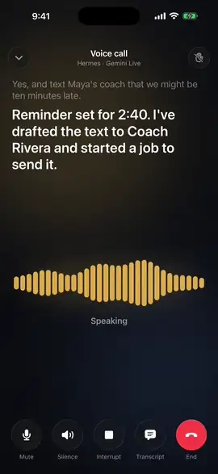
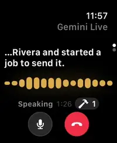
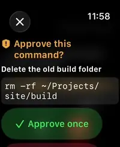

# Hermes Conduit

Qwen Live is an independently selectable provider alongside Gemini Live.
See [setup and validation limits](docs/QWEN_LIVE.md).

A native iPhone, iPad and Apple Watch app for [Hermes Agent](https://github.com/NousResearch/hermes-agent). Free, no ads, no tracking.

[](https://apps.apple.com/us/app/hermes-conduit/id6790977764)
[](https://testflight.apple.com/join/gcF9BBJ3)
[](https://hermesconduit.app)
[](https://ko-fi.com/agrias)

## See it in action

<table>
  <tr>
    <td align="center" valign="top"></td>
    <td align="center" valign="top"></td>
    <td align="center" valign="top"></td>
  </tr>
  <tr>
    <td align="center">Talk to Hermes live, and talk over it</td>
    <td align="center">Call from your wrist</td>
    <td align="center">Approve a command on the Watch</td>
  </tr>
</table>

More on [hermesconduit.app](https://hermesconduit.app): [live voice](https://hermesconduit.app/voice/), [Apple Watch](https://hermesconduit.app/watch/), [CarPlay](https://hermesconduit.app/carplay/) and [privacy](https://hermesconduit.app/privacy/).

Want new features sooner? The [TestFlight beta](https://testflight.apple.com/join/gcF9BBJ3) gets newer builds before they reach the App Store.

## What it does

Conduit is a touch-first app for your own Hermes agent on iPhone, iPad and Apple Watch, with CarPlay, widgets and Live Activities. It signs in to the Hermes dashboard you run, so your sessions, profiles, bots, tools and scheduled jobs are the same ones you use on desktop. Start a conversation on desktop and pick it up on your phone: the session list is the same because it is the same database.

The app works with any Hermes dashboard on its own. The free [Hermes Conduit Notifier](https://github.com/kaishi00/hermes-conduit-notifier) plugin on your host adds notifications, live voice, Apple Watch calls, rich cards and the phone features below.

## Features

**Chat**

- Streaming replies with Markdown, highlighted code, math, Mermaid diagrams and task lists
- Thinking, tool calls and each turn's steps, shown live or folded away; delegated-agent progress
- Map, place, travel, media, contact and info cards that Hermes draws in the chat
- HTML pages Hermes draws with `::preview` (charts, small dashboards) show in the reply up to 900 points tall, their foot fading when there's more; tap one to open it full screen, where you can touch and scroll it. A page's `window.hermes.send` answers `undelivered`: Conduit doesn't send prompts from a page
- Answer Hermes' questions with a tap, or in a short form when it needs several details: fill in what you know and leave the rest blank
- Attach photos, camera shots and any file, or drag them onto a chat (Finder on a Mac, Files on an iPad); a long paste becomes a text attachment you can open, edit or put back as text; quote a message, react to it, copy it
- Open a picture full screen and swipe through the chat's pictures (or Artifacts' or a folder's): pinch or double-tap to zoom, swipe down to close, share or save
- Steer, queue or stop a running turn; context meter; slash commands
- Branch, pin (in the order you set), archive and delete sessions; project chats, with a dot on a project that holds an unread reply; Artifacts browser for every file and page Hermes made
- Browse the chat's folder and your projects' folders beside Artifacts: preview and edit files, search names and contents, make, rename, move and delete files, upload from the phone, and tap a file path in a reply to open it (the folder's search and changes need the plugin)
- Saved chats open instantly, and you can type while Conduit reconnects

**Voice**

- Live voice calls with Gemini Live, Qwen Live, GPT-Live (ChatGPT subscription or API key), Grok Live, or Local Live on your own speech server, with echo cancellation and talking over Hermes
- Start, check and cancel Hermes jobs by voice; results come back into the call
- Calls stay with their chat, keep going with the screen locked, shrink to a bar while you read, and are saved as chats you can resume
- Hermes calls you: a CallKit call when a job is done, Hermes needs you, or a check you scheduled is due, on the phone or the Watch
- Classic voice and dictation with on-device, Apple, Hermes or your own speech-to-text, spoken Stop and End, wake phrases, and Read Aloud for any reply
- Apple Watch app that calls on its own, CarPlay, Siri and the Action Button; Watch and Siri calls can start on a profile you pick, whichever one the iPhone has open

**Tasks, bots and groups**

- Tasks board for Hermes' Kanban tasks
- Bots and their Bot Chats, with each bot's model, skills, tools and MCP servers, pictures Hermes can generate, and @mentions that bring another bot in; gateway-hosted group chats with @mentions, files and approvals
- Scheduled jobs: review runs, run now, edit, mute their notifications, delete
- Pulse (beta): once you turn it on, Hermes brings things up on its own (a morning brief, follow-ups on what you said you'd do, deadlines and birthdays) as cards you can act on, rate or put off, and learns what's worth raising

**Your phone, if you allow it**

Each is off until you turn it on, and goes only to your own Hermes host, encrypted end to end. The keys are agreed over your dashboard connection, so use HTTPS or a private tunnel such as Tailscale to keep anyone on the network from stepping into that exchange:

- Location and place rules, travel times, directions and navigation
- Calendar and reminders, with each change asked first unless you allow adds
- Apple Health data
- Focus and phone status, alarms and timers, and contacts you pick
- Ask Hermes about what's on your screen, or send anything from Shortcuts or the share sheet

**Notifications and control**

- Approve tools and answer questions straight from a notification, end-to-end encrypted between your host and your phone
- Live Activities on the Lock Screen and in the Dynamic Island while a reply runs
- Home Screen widgets to start a chat or talk in one tap
- Provider, model and reasoning effort switching mid-conversation
- Connect model providers in Settings > Models & providers: sign in, paste an API key once for every profile (or give one profile its own), or add your own OpenAI-compatible server. Keys stay on your Hermes host and are never shown again
- Pick the helper models Hermes runs smaller jobs on (chat titles, compaction, reading images, Conduit predictions and the rest) in Settings > Models & providers > Helper models, and the order a provider's keys take turns in on its page
- Multiple dashboards and profiles, each with its own credentials and settings; rename a profile or change its photo and glow in Settings > Profiles; All in the profile row lists every profile's chats together, newest first with each row's profile picture, or grouped by profile with each profile's pinned chats and five newest until Show more
- Capabilities: skills, tools, connectors (MCP servers you can test and edit, by form or as JSON) and plugins, plus Hermes settings and gateway logs
- Native OAuth sign-in through your dashboard, QR code and setup links, Cloudflare Access service tokens
- Face ID or Touch ID lock, credentials in the Keychain
- Available in English, French, German, Indonesian, Italian, Japanese, Korean, Polish, Portuguese (Brazil), Russian, Simplified Chinese, Spanish, Traditional Chinese and Turkish

## Requirements

- iPhone or iPad on iOS 17 or later; Apple Watch app on watchOS 10 or later (calls from the Watch need watchOS 11 or later, and some other features need newer versions)
- A running Hermes Agent instance with the native dashboard enabled (default port 9119)

## Connecting

**If Hermes is already running, that's all you need.** Conduit talks to the web dashboard that comes with Hermes (`hermes dashboard`, port 9119 by default). There is no Conduit server or container to install. The [companion plugin](#notifications-voice-and-phone-features) is optional but unlocks notifications, live voice and the phone features, and it installs with one command.

You need three things from your Hermes host: the dashboard running with a username and password, a way for your phone to reach it, and the address to type into Conduit. Your Hermes agent can set all of that up for you.

### The easy way: ask Hermes

1. Install [Tailscale](https://tailscale.com/download) on your iPhone or iPad and sign in. It's free, and it lets your phone reach Hermes securely from anywhere without opening anything to the internet.
2. Copy the prompt below and send it to your Hermes agent wherever you normally talk to it: Telegram, Discord, the terminal, or the Chat page of the Hermes dashboard.
3. Hermes replies with an address, a username and a password, plus a sign-in link. Tap the link on your phone, or open Conduit and type the details in. If Hermes shows a QR code, tap **Scan Code** on Conduit's sign-in screen.

```text
I want to use the Hermes Conduit app on my iPhone to talk to you. Conduit signs in to the Hermes web dashboard (the one started by `hermes dashboard`, default port 9119). Please set everything up and then tell me what to enter in the app.

1. Check whether the Hermes dashboard is running and which port it uses. If it isn't, start it, and make sure it starts again after a reboot.
2. Make sure the dashboard requires a sign-in. Never turn authentication off. If no username and password are set up yet, create them (HERMES_DASHBOARD_BASIC_AUTH_USERNAME and HERMES_DASHBOARD_BASIC_AUTH_PASSWORD in the Hermes .env file), and set HERMES_DASHBOARD_BASIC_AUTH_SECRET to a long random value so I stay signed in when the dashboard restarts.
3. Set up remote access with Tailscale Serve: check that Tailscale is installed and signed in on this machine, then run `tailscale serve --bg 9119` (with the dashboard's real port) and set dashboard.public_url in config.yaml to the https://<machine>.<tailnet>.ts.net address that Serve gives you. If the dashboard only listens on 127.0.0.1, leave it that way. Never open the dashboard port to the internet.
4. Install the Conduit companion plugin: `hermes plugins install kaishi00/hermes-conduit-notifier --enable`
5. If something needs me (installing or signing in to Tailscale, turning on HTTPS certificates for my tailnet, or a step on the host because you run inside a Docker container or on a NAS and can't make the change yourself), stop and tell me exactly what to do or which commands to run, then continue once I've done it.
6. When it's ready, tell me the address to enter in Conduit, the username and the password. Also make me a sign-in link: conduit://connect?url=ADDRESS&username=USERNAME&password=PASSWORD with each value percent-encoded and the full https:// address, never localhost. If we're talking in a terminal, show the link as a QR code there so the password stays out of chat history.
7. Last, restart the gateway and the dashboard so the plugin and the new settings load. Do this only after you've sent me everything from step 6, because the restart may end this conversation.
```

Only using Conduit at home on the same Wi-Fi? You can skip Tailscale: replace step 3 with "Make the dashboard reachable from other devices on my local network and tell me this machine's local IP address and the dashboard port." That address only works at home.

Conduit also has this built in: on the sign-in screen, **Need help connecting?** walks through the same questions and gives you a ready-to-copy prompt for each step.

### Hermes in Docker or on a NAS

Conduit works the same when Hermes runs in a container: all it needs is the dashboard. The differences:

- **Turn the dashboard on.** The official image runs the dashboard only when `HERMES_DASHBOARD=1` is set, and the port must be published (`-p 9119:9119`). If you can open the dashboard in a browser already, this part is done.
- **Sign-in comes from the container's environment.** Inside a container the dashboard listens on all interfaces, so Hermes refuses to start it without a sign-in. Set `HERMES_DASHBOARD_BASIC_AUTH_USERNAME`, `HERMES_DASHBOARD_BASIC_AUTH_PASSWORD` and `HERMES_DASHBOARD_BASIC_AUTH_SECRET` on the container (or in the `.env` file in its data folder).
- **Tailscale goes on the NAS, not in the container.** Synology, QNAP, Unraid and TrueNAS all have a Tailscale app. Install it, sign in, then run `tailscale serve --bg 9119` on the NAS and set `dashboard.public_url` in the mounted `config.yaml` to the `https://….ts.net` address it prints. The agent inside the container can't do this part, so the prompt above asks it to tell you the steps.
- **Install the plugin from the host.** `docker exec -it hermes hermes plugins install kaishi00/hermes-conduit-notifier --enable`, then `docker restart hermes`. Plugins live in the data volume (`/opt/data`), so they survive image updates.

A minimal example (pick your own username and password; the secret can be any long random string, such as the output of `openssl rand -base64 32`):

```sh
docker run -d --name hermes --restart unless-stopped \
  -v ~/.hermes:/opt/data \
  -p 9119:9119 \
  -e HERMES_DASHBOARD=1 \
  -e HERMES_DASHBOARD_BASIC_AUTH_USERNAME=me \
  -e HERMES_DASHBOARD_BASIC_AUTH_PASSWORD='a-strong-password' \
  -e HERMES_DASHBOARD_BASIC_AUTH_SECRET='a-long-random-string' \
  nousresearch/hermes-agent gateway run
```

On your home network the address is then `http://<nas-ip>:9119`; through Tailscale Serve it is the `https://….ts.net` address. See Hermes' [Docker guide](https://hermes-agent.nousresearch.com/docs/user-guide/docker) for the full set of options.

### Setting it up by hand

1. **Give the dashboard a sign-in.** Add these to `~/.hermes/.env` (the secret keeps you signed in across restarts):
   ```sh
   HERMES_DASHBOARD_BASIC_AUTH_USERNAME=me
   HERMES_DASHBOARD_BASIC_AUTH_PASSWORD=a-strong-password
   HERMES_DASHBOARD_BASIC_AUTH_SECRET=a-long-random-string
   ```
2. **Choose how your phone reaches it.**
   - **Tailscale Serve (recommended).** Run the dashboard on the default `127.0.0.1:9119`, run `tailscale serve --bg 9119`, and set `dashboard.public_url` in `~/.hermes/config.yaml` to the `https://<machine>.<tailnet>.ts.net` address Serve prints (Hermes needs this to keep the sign-in on for Tailscale visitors). Install Tailscale on the phone with the same account. The address for Conduit is that `https://….ts.net` URL.
   - **Same network only.** Run `hermes dashboard --host 0.0.0.0 --port 9119 --no-open`. The address is `http://<server-ip>:9119` and works only on that network.
   - **Your own domain or reverse proxy.** Point the proxy at `http://127.0.0.1:9119` and set `dashboard.public_url` to your HTTPS address.
3. **Keep the dashboard running** with systemd, launchd, tmux or similar, so it survives reboots.
4. **Sign in.** Open Conduit, enter the address and sign in with the username and password from step 1.
5. **Add the plugin** as described in [Notifications, voice and phone features](#notifications-voice-and-phone-features), or from **Settings > Conduit plugin** once you're signed in.

**Note:** Conduit connects to the native Hermes dashboard, not the separate Hermes WebUI project. The default port is 9119. The address of the gateway's own web listener (the one `hermes webapp` serves, port 9120 by default) works too.

Plain HTTP over Tailscale (MagicDNS `.ts.net` domains and `100.64.0.0/10` tailnet IPs) is supported, since that traffic is already WireGuard-encrypted.

Conduit only needs Tailscale Serve, which shares the dashboard with devices on your own tailnet. It doesn't need Tailscale SSH, so leave that off unless you use it for something else, and keep Tailscale updated on every device, including older ones like an iPad or Apple TV. Tailscale posts fixes on its [security bulletins](https://tailscale.com/security-bulletins) page.

If the dashboard is behind Cloudflare Access, enable the optional service token on the login screen or in Settings > Connection (the first row, under your profile name). Conduit stores the client secret in Keychain (scoped to the gateway origin), and injects both Access headers into native authentication requests, WebSocket handshakes, and all in-page WebKit fetches via a document-start user script. Credentials are bound to the gateway URL and cleared when switching to a different host.

**Native OAuth limitation:** service-token headers cannot be attached to the system Safari navigation that opens `/auth/native/authorize`. Native OAuth therefore requires that browser authorization route to be reachable through an interactive Cloudflare policy or without a service-token challenge. The token exchange, refresh, REST, and WebSocket-ticket requests still use the configured service-token headers. A service-token-only challenge in front of the authorize route cannot be bypassed by Conduit and must not silently fall back to embedded Google OAuth.

## Notifications, voice and phone features

Push notifications need a small relay because iOS does not let apps keep a background connection open. Live voice, Apple Watch calls, cards and the phone features need the notifier plugin on your Hermes host. One install covers all of it; the relay and plugin source live in [hermes-conduit-notifier](https://github.com/kaishi00/hermes-conduit-notifier).

Install the notifier plugin on your Hermes instance:

```
hermes plugins install kaishi00/hermes-conduit-notifier --enable
hermes gateway restart
```

Then turn on notifications under Settings > Notifications; Conduit pairs the signed-in profile by itself when no other iPhone receives its notifications; if one does, Settings > Notifications offers to move them to this one. Settings > Conduit plugin shows the installed version and can update it.

The app uses a shared relay by default (`push.milim.dev`) so notifications work out of the box with no extra setup.

**End-to-end encryption.** With notifier 0.5 or later, Conduit gives each pairing its own key over your dashboard connection (never through the relay) and turns encryption on by itself. Notification text, session and profile names, approval and clarify cards, and your clarify answers are then encrypted between your Hermes host and this iPhone; a Notification Service Extension decrypts them on the phone. The relay and Apple only see routing data such as the event type and timing. With notifier 0.71 or later the keys rotate, or when you tap Rotate encryption keys in Settings > Notifications; the old key still opens notifications already on their way for 7 days. With notifier 0.72 or later they rotate every 7 days through a key exchange inside the encrypted channel, so a new key normally never crosses your dashboard connection (if a rotation can't finish, Conduit falls back to handing over a new key through that connection, then replaces it through the exchange); on iOS 26 that exchange uses ML-KEM-768 with X25519 and is quantum-safe, shown with a shield instead of the padlock. Settings > Notifications shows which pairings are encrypted, and a padlock marks a saved dashboard whose hosts all confirmed they seal with this iPhone's current key.

**Running your own relay.** Apple only delivers notifications for the App Store build when they are signed with its developer's APNs key, so a relay you run yourself can't reach the App Store app, even if you enter its URL under Settings > Notifications > Push relay. A self-hosted relay works with a Conduit build you sign with your own Apple developer account and bundle id (see [Building from source](#building-from-source) and the relay's [self-hosting guide](https://github.com/kaishi00/hermes-conduit-notifier#self-hosting)). Such a build registers under its own bundle id, and can make your relay its default with the `CONDUIT_DEFAULT_RELAY_URL` build setting (an https URL, e.g. `xcodebuild CONDUIT_DEFAULT_RELAY_URL=https://push.example.com …`), so nobody has to type it into Settings. If your goal is that the relay can't read your notifications, end-to-end encryption already covers that on the shared relay.

## Building from source

```
git clone https://github.com/kaishi00/hermes-conduit.git
cd hermes-conduit
brew install xcodegen
xcodegen generate
open Conduit.xcodeproj
```

Select your team in Signing & Capabilities, then build and run on your device.

**On a Mac.** Gatekeeper refuses a Conduit that Xcode launches directly on a Mac. `scripts/mac-dev-build.sh` builds a development-signed **Conduit Dev** instead and installs it in /Applications through macOS's iOS App Installer. Conduit Dev runs beside the App Store or TestFlight Conduit, with its own bundle id, sign-in and settings. A rebuild moves the installed Conduit Dev to the Trash first, which asks for an admin password, because iOS App Installer adds a numbered copy instead of replacing it. It has no widgets, extensions, Watch app, push notifications, CarPlay voice or location push, and `conduit://` links keep opening the installed Conduit. It uses the maintainer's team; another team changes `teamID` in `scripts/mac-dev/ExportOptions.plist`, `DEVELOPMENT_TEAM` in the root `project.yml` (which every build uses), and the bundle id `com.milim.relay.dev` in `scripts/mac-dev/project.yml` and `scripts/mac-dev-build.sh`.

**Requirements:**
- A current Xcode with the iOS 26 and watchOS 26 SDKs or later (CI builds with the default Xcode on GitHub's `macos-26` runners)
- [xcodegen](https://github.com/yonaskolb/XcodeGen)

## Releasing

See [the iOS release workflow](docs/RELEASE_WORKFLOW.md) for the TestFlight and App Store release process.

## Architecture

Conduit is SwiftUI, generated with xcodegen from `project.yml`. Targets: the iPhone and iPad app, the Watch app and its widgets, Home Screen widgets and Live Activities, a Notification Service Extension (decrypts end-to-end encrypted notifications), a Location Push extension, and a share extension.

The app connects to the Hermes dashboard's WebSocket (`/api/ws`) and REST routes after authenticating through the dashboard, as the desktop client does. On the gateway's own listener the same socket is answered by Hermes' session authority, which takes other shapes for the same requests; Conduit reads which one it reached from the socket's `gateway.ready` and sends each its own. Plugin features use the notifier's routes under `/api/plugins/conduit_push/`, behind the same dashboard auth.

Key places:
- `Conduit/Services/HermesClient.swift` - WebSocket client and RPC layer
- `Conduit/Services/AppState.swift` (and its `AppState+*.swift` extensions) - state and session lifecycle
- `Conduit/Views/V2/` - the app shell: Chats, Tasks, Bots, Settings
- `Conduit/Voice/` - Classic voice, dictation and the live voice engines (Gemini Live, Qwen Live, GPT-Live, Grok Live, Local Live)
- `Conduit/Health`, `Conduit/Location`, `Conduit/Phone` - opt-in phone data sync
- `ConduitWatch/` - the Apple Watch app
- `Shared/` - code shared with the extensions and the Watch
- `docs/FEATURE_MAP.md` - features that must change together, such as one behavior across the voice modes, the Watch and CarPlay ([CONTRIBUTING.md](CONTRIBUTING.md) says how to use it)

## Privacy

Conduit has no analytics, telemetry, crash-reporting or ad SDKs, and its developer never receives your conversations, voice or phone data. After a crash or freeze, Conduit asks once whether to send that report (call stacks and codes, the version, iOS version and device model, and what the chat screen did just before: scrolling, sizes and timings, never message text) to its developer, through the developer's push relay; it goes only if you tap Send. A chat trace you send from Settings > Connection > Diagnostics & logs, after a chat jumps or gets stuck, goes the same way. Chats, attachments and opt-in phone data go to your own Hermes host. Live voice calls go to the voice provider you choose (Google, Alibaba Cloud, OpenAI or xAI) or your own speech server. The optional push relay delivers notifications and calls through Apple; with end-to-end encryption on, it sees only their routing data, not their content. A crash report or chat trace you send isn't end-to-end encrypted: the developer's relay keeps what it says.

The full [privacy policy](https://kaishi00.github.io/hermes-conduit-notifier/privacy/) says what each party receives.

## Support

- Website: [hermesconduit.app](https://hermesconduit.app)
- Bug reports: [GitHub issues](https://github.com/kaishi00/hermes-conduit/issues)
- Email: [developer@hermesconduit.app](mailto:developer@hermesconduit.app)

## License

MIT

The live voice orb uses the shader from [Liquid Orb Editor](https://github.com/lersent001/orb) by LerSent001 (MIT); its notice is in `Conduit/Views/LiquidOrb/LiquidOrb.metal`.

## Disclaimer

Hermes Conduit is an independent project and is not affiliated with or endorsed by Nous Research.
